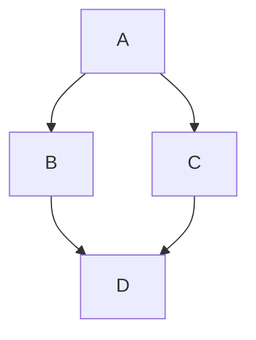
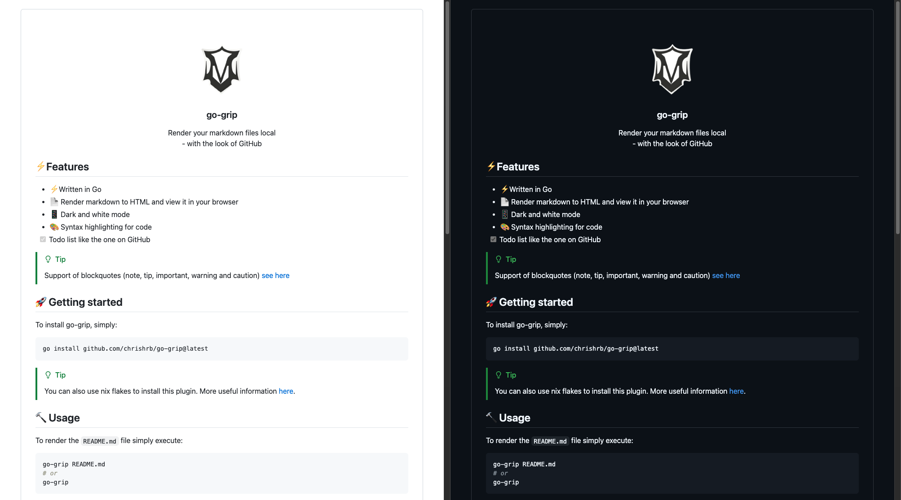

<!-- PROJECT LOGO -->
<br />
<div align="center">
  <a href="#">
    
  </a>

  <h3 align="center">go-grip</h3>

  <p align="center">
    Render your markdown files local<br>- with the look of GitHub
  </p>
</div>

## Table of Contents

- [About](#question-about)
- [Features](#zap-features)
- [Getting started](#rocket-getting-started)
- [Usage](#hammer-usage)
- [Examples](#pencil-examples)
- [Known TODOs / Bugs](#bug-known-todos--bugs)
- [Similar tools](#pushpin-similar-tools)

## :question: About

**go-grip** is a lightweight, Go-based tool designed to render Markdown files locally, replicating GitHub's style. It offers features like syntax highlighting, dark mode, and support for mermaid diagrams, providing a seamless and visually consistent way to preview Markdown files in your browser.

This project is a reimplementation of the original Python-based [grip](https://github.com/joeyespo/grip), which uses GitHub's web API for rendering. By eliminating the reliance on external APIs, go-grip delivers similar functionality while being fully self-contained, faster, and more secure - perfect for offline use or privacy-conscious users.

## :zap: Features

- :zap: Written in Go :+1:
- 📄 Render markdown to HTML and view it in your browser
- 📱 Dark and light theme
- 🎨 Syntax highlighting for code
- [x] Todo list like the one on GitHub
- Support for github markdown emojis :+1:
- Support for mermaid diagrams
- hashtag linking in page (see table of contents)
- math expressions (code, inline, block)
- gh issues and prs #46 and grafana/grafana#22
- toggle state is preserved in [sessionStorage](https://developer.mozilla.org/en-US/docs/Web/API/Window/sessionStorage)

This is an inline $\sqrt{3x-1}+(1+x)^2$ function.

$$\left( \sum_{k=1}^n a_k b_k \right)^2 \leq \left( \sum_{k=1}^n a_k^2 \right) \left( \sum_{k=1}^n b_k^2 \right)$$

```math
\left( \sum_{k=1}^n a_k b_k \right)^2 \leq \left( \sum_{k=1}^n a_k^2 \right) \left( \sum_{k=1}^n b_k^2 \right)
```



```go
package main

import "github.com/chrishrb/go-grip/cmd"

func main() {
	fmt.Sprintln("Welcome to Grip! Use `go-grip --help` for more information.")
}
```

> [!TIP]
> Support of blockquotes (note, tip, important, warning and caution) [see here](https://github.com/orgs/community/discussions/16925)

> [!IMPORTANT]
>
> test

## :rocket: Getting started

To install go-grip, simply:

```bash
go install github.com/chrishrb/go-grip@latest
```

> [!TIP]
> You can also use nix flakes to install this plugin.
> More useful information [here](https://nixos.wiki/wiki/Flakes).

## :hammer: Usage

To render the `README.md` file simply execute:

```bash
go-grip README.md
# or
go-grip
```

The browser will automatically open on http://localhost:6419. You can disable this behaviour with the `-b=false` option.

You can also specify a port:

```bash
go-grip -p 80 README.md
```

By default the server only listens on `localhost`, so it is not reachable from other machines. To listen on a specific interface pass its IP address with `-H`, or use `0.0.0.0` to listen on all interfaces:

```bash
go-grip -H 0.0.0.0 README.md
```

or just open the folder page for the current directory:

```bash
go-grip
```

The folder page shows a table of the folder's entries (folders first, with size and modification time) and, if the folder has a `README.md`, renders it below the table, like GitHub does. Every folder you open in the browser gets the same page. Use the arrow keys (or `j`/`k`) to move between rows, Enter to open a file or folder, and Backspace or ← to go up to the parent folder.

To serve another folder, pass it as the argument (with or without a trailing slash):

```bash
go-grip docs/
```

go-grip then serves that folder as the root and opens its folder page. A file argument serves the file's folder and opens the file. If the given path does not exist, go-grip prints an error and exits with status 1 instead of starting the server.

Dark mode is not a launch option: use the toggle in the top right corner of the page. Your choice is stored in the browser's local storage, so each browser remembers its own theme. Without a stored choice the page follows the operating system's `prefers-color-scheme` setting.

Below it, the width toggle (↔) opens a panel to set the content width to 70%, 80% or 90% of the window, to a custom two-digit percentage typed into the field below the options, or back to Auto (GitHub's 896px). Like the theme, the choice is stored in the browser's local storage. The toggle is hidden on windows narrower than 940px, where the content already spans the full width.

By default each open page reloads when something it shows changes: a Markdown page when its file or a local image it references is saved, a folder page when an entry in that folder is added, removed, renamed or written. Saving an unrelated file does not reload the page, and editor temp and swap files are ignored.

To disable automatic browser reload on file changes (useful for stable editing):

```bash
go-grip --no-reload README.md
```

go-grip logs to stderr. `--log-level` sets how much it prints: `error`, `warn`, `info` (the default) or `debug`. At `info` you only see the startup lines, warnings and errors; `error` hides the startup lines too. `debug` adds a timestamped line for every request (method, path, status, duration), every file system event and whether it was ignored, each debounced reload and how many events it coalesced, and each live reload connection. Attach that output when reporting a reload problem:

```bash
go-grip --log-level=debug README.md
```

The browser page title is derived from the Markdown filename (`my-guide_v2.md` becomes `My Guide V2`).

To check which build you are running:

```bash
go-grip --version
```

To terminate the current server simply press `CTRL-C`.

### Use with AI tools (MCP)

`go-grip mcp` runs go-grip as a [Model Context Protocol](https://modelcontextprotocol.io) server over stdin/stdout. It exposes one tool, `preview_markdown`, which opens a Markdown file or folder in your browser. That lets AI tools such as Claude Code, Claude Desktop or Cursor show you the plans and docs they write. Each previewed folder is served on a free localhost port, and the page live-reloads while the agent keeps editing the file.

Register it with Claude Code:

```bash
claude mcp add --scope user go-grip -- go-grip mcp
```

or add it to the MCP config of Claude Desktop, Cursor and others:

```json
{ "mcpServers": { "go-grip": { "command": "go-grip", "args": ["mcp"] } } }
```

Then ask for a preview, e.g. *"preview the plan with go-grip"*. The `mcp` subcommand accepts `-b=false`, `--bounding-box`, `--no-reload` and `--log-level` like the main command. To preview a file that is literally named `mcp`, run `go-grip ./mcp`.

## :pencil: Examples



## :bug: Known TODOs / Bugs

- [ ] Make it possible to export the generated html

## :pushpin: Similar tools

This tool is a Go-based reimplementation of the original [grip](https://github.com/joeyespo/grip), offering the same functionality without relying on GitHub's web API.
